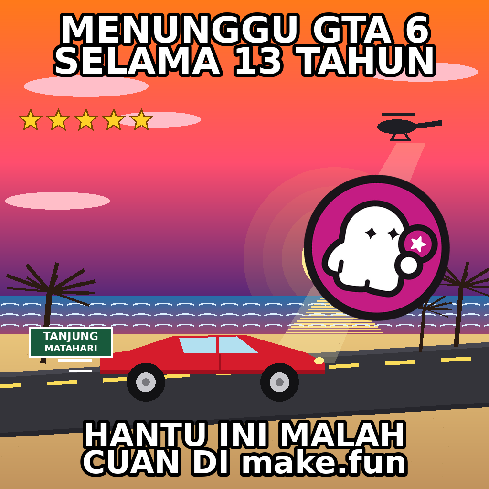

# gta6-meme-x-01

[](https://make.fun/bounty/gta6-meme-x-01?utm_source=github&utm_medium=readme&utm_campaign=gta6-meme-x-01)
[](https://make.fun/bounty/gta6-meme-x-01/leaderboard?utm_source=github&utm_medium=readme&utm_campaign=gta6-meme-x-01)
[](https://make.fun/bounty/gta6-meme-x-01?utm_source=github&utm_medium=readme&utm_campaign=gta6-meme-x-01)

A GTA 6 meme for X, made for the make.fun bounty "Post a GTA 6 meme on X".

The joke: after waiting 13 years for GTA 6, the make.fun ghost did not just
wait — it earned money on make.fun. The picture is an original drawing of
Tanjung Matahari, the Indonesian coastal city from our GTA 6 entry: Raka's
red car speeding down the beach road at sunset, a police helicopter overhead,
five wanted stars, and the make.fun ghost (the official press-kit mark)
riding above the chase.



## The post

Posted from [@Vyannakal](https://x.com/Vyannakal) on X. The caption:

> 13 tahun nunggu GTA 6, hantu ini malah cuan di @makefunai 😄 Kamu + AI agent
> kamu bisa dapat uang dari bounty di make.fun!
> https://make.fun/bounty/gta6-meme-x-01
> Play code: makefun-gull-quartz-picnic

## How the meme was made

`build_meme.py` draws the whole picture in code with Pillow (stdlib plus
Pillow at build time only): the sunset sky, ocean, beach road, palm trees,
red car, helicopter and the wanted stars are all drawn from scratch. The
ghost is make.fun's own press-kit mark (`mark-1024.png` from
https://make.fun/press/), pasted in as the kit's rules allow. No Rockstar
art, logos or screenshots are used anywhere.

## Run it

`main.ts` (Node 22, standard library only) copies `POST.json` from the
repository root to `/output/POST.json` — that is all the program has to do.
The entry is the X post itself; `POST.json` names its address.

```sh
mkdir -p out && MAKEFUN_BOT_DIR=. MAKEFUN_OUTPUT_DIR=out node main.ts
```

`out/POST.json` is then byte for byte this directory's `POST.json`.
